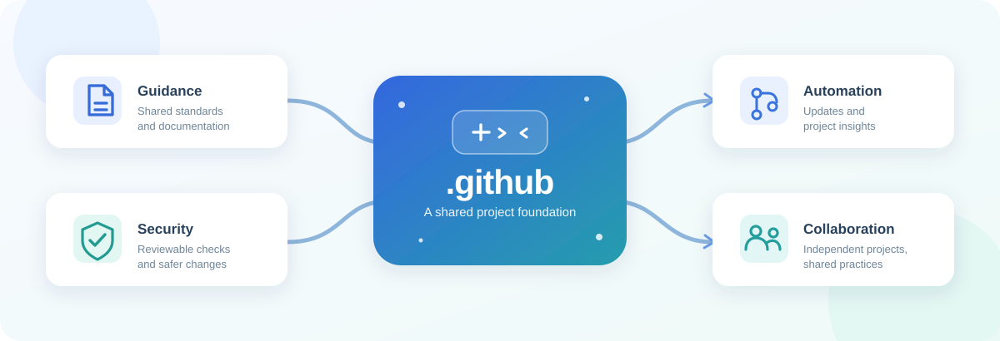
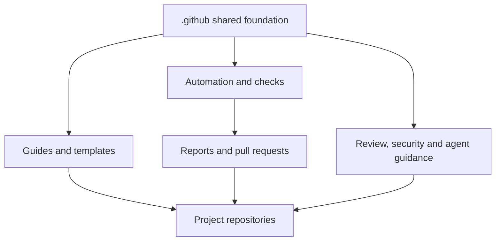

# .github | A shared foundation for my projects

> [Leia em português](README.pt-BR.md)

Maintaining software projects involves more than writing code. It also means welcoming contributions, keeping dependencies up to date, reviewing changes and paying attention to security.

This repository brings together **guidance and automation shared across my projects**. The goal is to avoid repeating the same work and keep practices consistent, while letting each repository make its own decisions.

## What does it do?

- **Makes collaboration easier.** Provides templates for reporting bugs, suggesting improvements and submitting contributions, alongside support and security guidance.
- **Helps keep .NET up to date.** Checks SDK versions and can suggest updates through pull requests instead of changing projects' default branches directly.
- **Makes projects easier to understand.** Collects information about .NET projects and highlights issues in automation tooling.
- **Supports code review and security.** Offers checks for accidentally exposed credentials and shared code-review configurations.
- **Organizes AI agent guidance.** Maintains reusable instructions and skills that individual projects can adopt.
- **Helps track improvements.** Brings quality-related GitHub issues together in a project view.

## How does it work?

Some files provide **shared community defaults** when a repository doesn't have its own version. Other tasks run through GitHub Actions: they produce reports or propose changes for review.

For example, when an eligible .NET SDK update is available, an automation can open a pull request. **The people maintaining that project still decide whether to accept it.**

Not every feature is installed automatically. Each repository can keep its own settings and choose the integrations that make sense for it.

## Explore further

- [**Architecture:**](docs/architecture.md) how the components fit together, with diagrams.
- [**Automation catalog:**](docs/workflow-catalog.md) all 13 workflows and their responsibilities.
- [**Visual workflows:**](docs/automation-flows.md) step-by-step diagrams of the main processes.
- [**Operations:**](docs/operations.md) how to run, troubleshoot and safely recover automations.

## Contributing and security

Suggestions and corrections are welcome. See the [contribution guidelines](CONTRIBUTING.md). For potential vulnerabilities, follow the [security policy](SECURITY.md) rather than opening a public issue.
