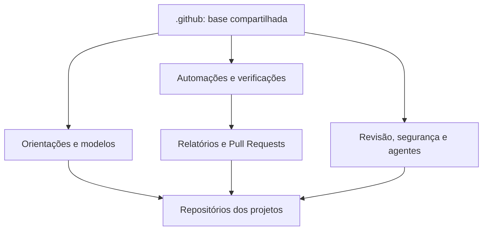

# .github | Uma base compartilhada para meus projetos

> [Read in English](README.md)

Manter projetos de software envolve mais do que escrever código. É preciso receber contribuições, acompanhar atualizações, revisar mudanças e cuidar da segurança.

Este repositório reúne **orientações e automações que podem ser compartilhadas entre meus projetos**. A ideia é evitar trabalho repetido e manter práticas consistentes, sem tirar a autonomia de cada repositório.

## O que ele faz?

- **Facilita a colaboração.** Oferece modelos para relatar problemas, sugerir melhorias e abrir contribuições, além de orientações de suporte e segurança.
- **Ajuda a manter o .NET atualizado.** Verifica versões do SDK e pode propor atualizações por Pull Request, sem alterar diretamente o código principal dos projetos.
- **Mostra o estado dos projetos.** Reúne informações sobre os projetos .NET e identifica pontos de atenção em ferramentas de automação.
- **Apoia revisões e segurança.** Disponibiliza verificações de possíveis credenciais expostas e configurações compartilhadas para revisão de código.
- **Organiza o uso de agentes de IA.** Mantém instruções e habilidades reutilizáveis que podem ser adotadas pelos projetos.
- **Ajuda a acompanhar melhorias.** Reúne questões de qualidade já registradas no GitHub em uma visão de projeto.

## Como funciona na prática?

Alguns arquivos servem como **padrões de comunidade** para os repositórios que não têm uma versão própria. Outras tarefas são executadas pelo GitHub Actions: produzem relatórios ou propõem alterações para revisão.

Por exemplo, quando existe uma atualização elegível do SDK .NET, uma automação pode abrir um Pull Request. **A decisão de aceitar a mudança continua com quem mantém o projeto.**

Nem todos os recursos são instalados automaticamente: cada repositório pode ter suas próprias configurações e optar pelas integrações que fazem sentido.

## Acompanhando os projetos

O [Repo Control Center](https://github.com/rodri-oliveira-dev/repo-status-dashboard) complementa este repositório com um [painel público](https://rodri-oliveira-dev.github.io/repo-status-dashboard/) para acompanhar builds, segurança, releases, atividade e versões das tecnologias. Ele coleta informações públicas de forma independente, sem controlar as automações daqui.

## Quer conhecer os detalhes?

- [**Arquitetura:**](docs/architecture.pt-BR.md) como as partes se conectam, com diagramas.
- [**Automações:**](docs/workflow-catalog.pt-BR.md) catálogo dos 13 workflows e suas responsabilidades.
- [**Fluxos ilustrados:**](docs/automation-flows.pt-BR.md) o que acontece em cada processo, passo a passo.
- [**Operação:**](docs/operations.pt-BR.md) como executar, investigar falhas e recuperar automações.

## Contribuições e segurança

Sugestões e correções são bem-vindas. Consulte as [orientações para contribuir](CONTRIBUTING.md). Para possíveis vulnerabilidades, siga a [política de segurança](SECURITY.md), em vez de abrir uma issue pública.
