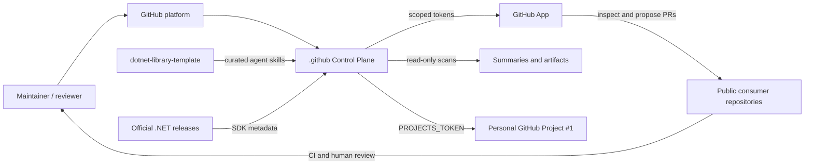
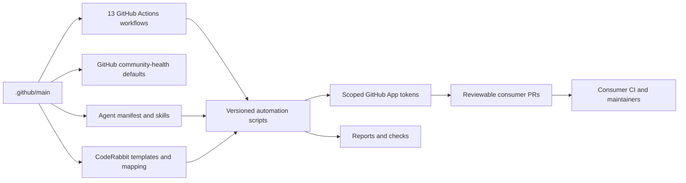
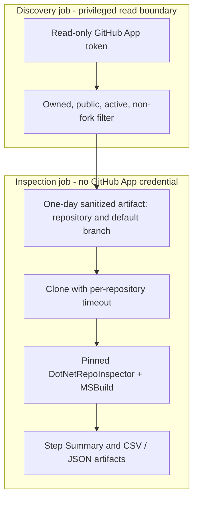

# Control plane architecture

> [Português](architecture.pt-BR.md) · [Workflow catalog](workflow-catalog.md) · [Execution flows](automation-flows.md) · [Operations](operations.md)

## Purpose and boundaries

This public `.github` repository combines **GitHub community-health defaults** and an **engineering control plane** for repositories owned by `rodri-oliveira-dev`. It is not an application runtime, production deployment orchestrator or central repository build pipeline. It provides maintained policy, source-controlled automation, reusable workflows and reviewable cross-repository changes.

Its actual scope is defined by the [13 workflow files](workflow-catalog.md), the [agent-governance manifest](../agent-governance/manifest.json), [CodeRabbit repository mapping](../coderabbit-templates/repositories.json) and the GitHub App installation. Not every owned repository is eligible for every automation.

## System context (C4-inspired)

The GitHub App authenticates individual workflows with short-lived installation tokens and narrowly requested permissions. The separate `PROJECTS_TOKEN` classic PAT is used for the Sonar-labeled issue synchronization. Neither a credential existing nor a configured cron proves that the latest run was successful.

## Container/component relationships (C4-inspired)

| Component | Responsibility | Boundary |
| --- | --- | --- |
| [Workflows](../.github/workflows/) | Triggers, inputs, permissions, checkout and job orchestration | A job's `GITHUB_TOKEN` permissions do not grant installation permissions to a GitHub App |
| [Automation scripts](../.github/scripts/automation/) | Repository discovery, validation, diff computation, Git/PR operations and reporting | Versioned scripts, reviewed through PRs |
| [Branch ownership](automation-branch-ownership.md) | Protect existing reserved branches, verify automation provenance and select recovery branches where implemented | Branch name alone is not proof of ownership |
| [Agent governance](../agent-governance/README.md) | One library profile, nine skills, four centrally managed upstream-owned skills | A consumer must already have managed files for automated distribution |
| [CodeRabbit profiles](../coderabbit-templates/repositories.json) | Five templates mapped to 20 repository entries | Distributes a `.coderabbit.yaml` remote-config pointer through PRs |
| [Secret scanning](secret-scanning.md) | Reusable Git-history scanner and fail-closed coverage policy | Consumer caller workflow must explicitly opt in |
| [Community defaults](../README.md#how-github-uses-this-repository) | Supported contribution, issue, PR, security and support policies | Local repository-specific files take precedence |

## Inventory trust boundaries

Only the discovery job holds the read-only GitHub App credential. It filters public, owned, non-archived, non-fork repositories before producing sanitized input for the isolated inspection job. The latter does not receive App secrets and may evaluate repository-defined MSBuild logic through the **SHA-pinned DotNetRepoInspector**. Clone and inspection timeouts bound the exposure. The resulting report is an inventory, **not proof that each repository builds or that a major upgrade is safe**.

## Change control and adoption

Cross-repository SDK, skill and CodeRabbit maintenance proposes **Pull Requests**; these automations do not merge consumer PRs automatically. Shared branch ownership is used by the SDK/skill synchronization and protects against force-pushing unproven historical branches. CodeRabbit distribution and runtime-audit remediation maintain their **own** provenance rules and do not necessarily support the same recovery branch mechanism.

GitHub automatically supplies supported *community-health* defaults only when a public consumer lacks its own file. **Workflows, Dependabot, CodeRabbit, AGENTS.md, skills and secret scanners are not implicitly inherited**. Each requires a local caller/configuration, manual installation or reviewable distribution PR.

The SDK synchronization changes eligible SDK **patch** versions only in root `global.json`, within the existing `major.minor` channel. Target frameworks, NuGet dependencies, Docker images and major migrations are out of scope; [major migration recommendations](dotnet-major-migration-policy.md) remain a policy/proposed evolution.

For per-workflow permissions and output, see the [catalog](workflow-catalog.md). For decision flows, see [Mermaid diagrams](automation-flows.md). For operational incidents, see [operations](operations.md).
