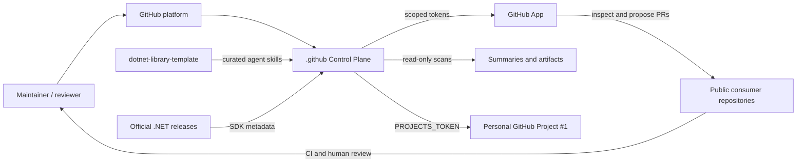
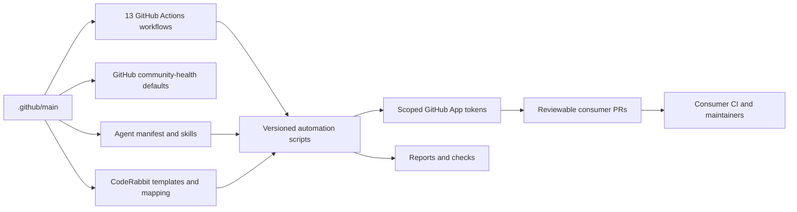
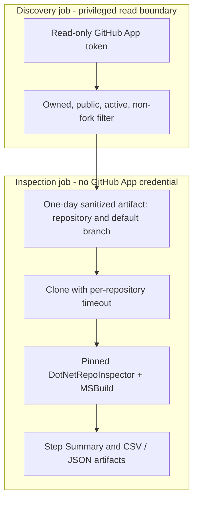

# Arquitetura do Control Plane

> [English](architecture.md) · [Catálogo de workflows](workflow-catalog.pt-BR.md) · [Fluxos de execução](automation-flows.pt-BR.md) · [Operação](operations.pt-BR.md)

## Objetivo e limites

Este repositório público `.github` combina **arquivos padrão de comunidade do GitHub** e um **Control Plane de engenharia** para repositórios de `rodri-oliveira-dev`. Não é um runtime de aplicação, orquestrador de deploy de produção ou pipeline central de build. Disponibiliza políticas, automações versionadas, workflows reutilizáveis e alterações revisáveis entre repositórios.

O escopo real é definido pelos [13 arquivos de workflow](workflow-catalog.pt-BR.md), pelo [manifesto de governança de agentes](../agent-governance/manifest.json), pelo [mapeamento CodeRabbit](../coderabbit-templates/repositories.json) e pela instalação da GitHub App. Nem todo repositório da conta é elegível para todas as automações.

## Contexto do sistema (inspirado em C4)

A GitHub App autentica workflows com tokens temporários e permissões delimitadas. O PAT clássico `PROJECTS_TOKEN`, separado, é usado para sincronizar issues rotuladas do Sonar com o Project pessoal. A existência de credenciais e agendamentos não comprova o sucesso da última execução.

## Relação entre componentes (inspirada em C4)

| Componente | Responsabilidade | Limite |
| --- | --- | --- |
| [Workflows](../.github/workflows/) | Gatilhos, entradas, permissões, checkout e orquestração de jobs | O `GITHUB_TOKEN` não substitui as permissões da instalação App |
| [Scripts de automação](../.github/scripts/automation/) | Descoberta, validação, comparação, operações Git/PR e relatórios | Scripts versionados e revisados por PR |
| [Ownership de branches](automation-branch-ownership.pt-BR.md) | Proteger branches reservadas, verificar origem e escolher recovery quando implementado | Nome da branch não comprova sua propriedade |
| [Governança de agentes](../agent-governance/README.md) | Um perfil de biblioteca, nove skills e quatro skills upstream gerenciadas | Consumidor precisa ter os arquivos gerenciados para distribuição |
| [Perfis CodeRabbit](../coderabbit-templates/repositories.json) | Cinco templates e 20 entradas de repositórios mapeados | Distribui ponteiro `.coderabbit.yaml` por PR |
| [Secret scanning](secret-scanning.pt-BR.md) | Scanner reutilizável de histórico Git com política fail-closed | Consumidor precisa configurar um workflow caller |
| [Arquivos de comunidade](../README.pt-BR.md#como-o-github-utiliza-este-repositório) | Padrões de contribuição, issues, PR, segurança e suporte | Arquivos específicos no consumidor têm prioridade |

## Fronteiras de confiança do inventário

Somente o job de descoberta recebe a credencial de leitura da GitHub App. Ele filtra repositórios públicos, próprios, não arquivados e sem fork antes de gerar uma entrada higienizada para o job isolado de inspeção. Esse segundo job não recebe secrets da App e pode avaliar lógica MSBuild própria dos projetos pelo **DotNetRepoInspector fixado por SHA**. Timeouts limitam clones e inspeções. O resultado é um inventário, **não uma prova de build nem de segurança de migração major**.

## Controle de alterações e adoção

As automações de SDK, skills e CodeRabbit propõem alterações entre repositórios por **Pull Requests**; não fazem merge automático dos PRs consumidores. O componente compartilhado de ownership protege a sincronização de SDK/skills contra sobrescrever branches históricas sem proveniência comprovada. A distribuição CodeRabbit e a remediação de runtimes de Actions possuem regras **próprias** de propriedade, que não precisam implementar a mesma recuperação de branch.

O GitHub herda arquivos *community health* suportados somente se não houver equivalente no repositório público consumidor. **Workflows, Dependabot, CodeRabbit, AGENTS.md, skills e scanners não são herdados automaticamente**. Precisam de caller/configuração local, instalação manual ou PR de distribuição revisável.

A sincronização de SDK altera apenas versões elegíveis de **patch** do SDK no `global.json` da raiz, no canal `major.minor` existente. Target frameworks, pacotes NuGet, imagens Docker e migrações major estão fora do escopo. A [política de migrações major](dotnet-major-migration-policy.pt-BR.md) ainda descreve uma evolução proposta.

Para permissões e saídas, veja o [catálogo](workflow-catalog.pt-BR.md). Para decisões, veja os [diagramas Mermaid](automation-flows.pt-BR.md). Para incidentes, consulte [operação](operations.pt-BR.md).
