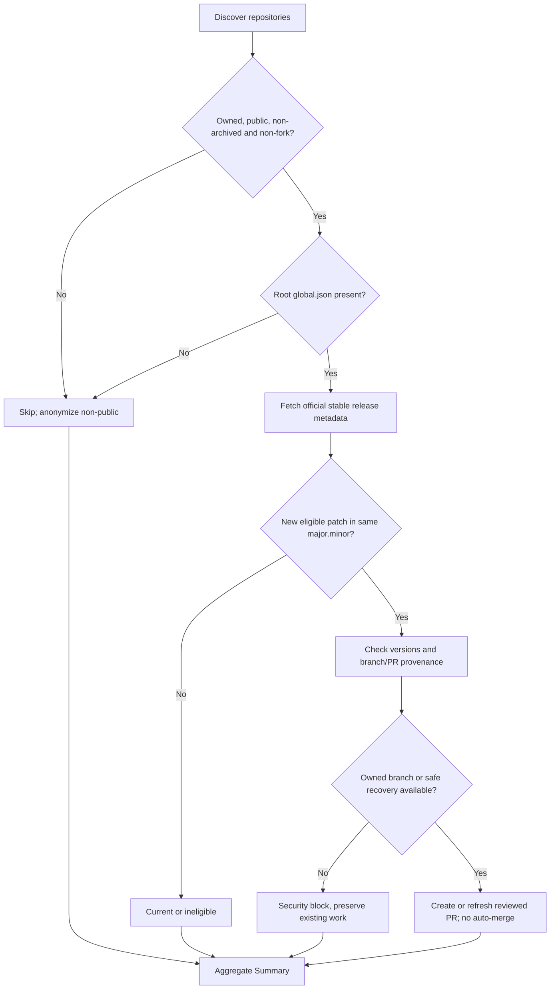
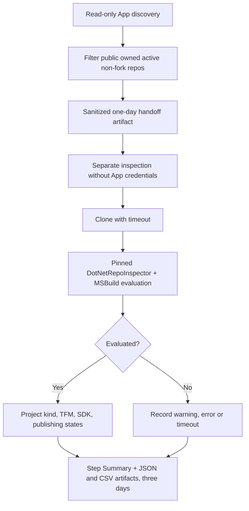
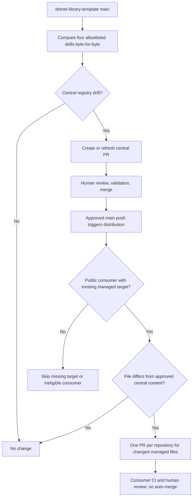
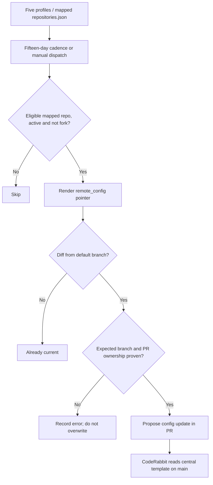
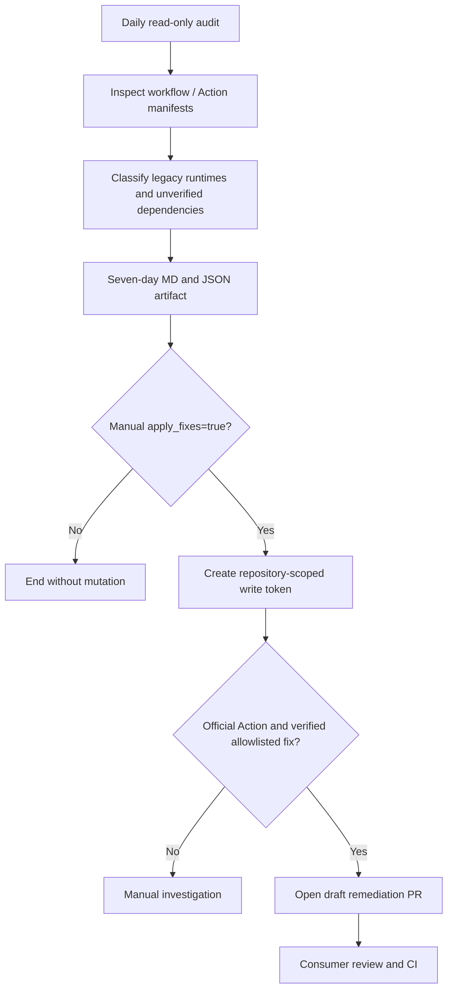
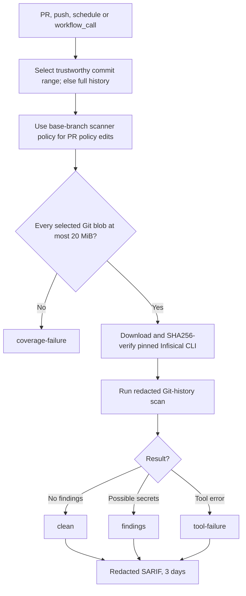
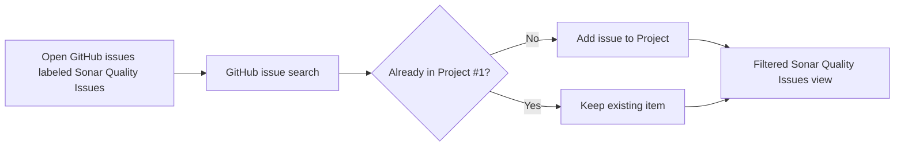
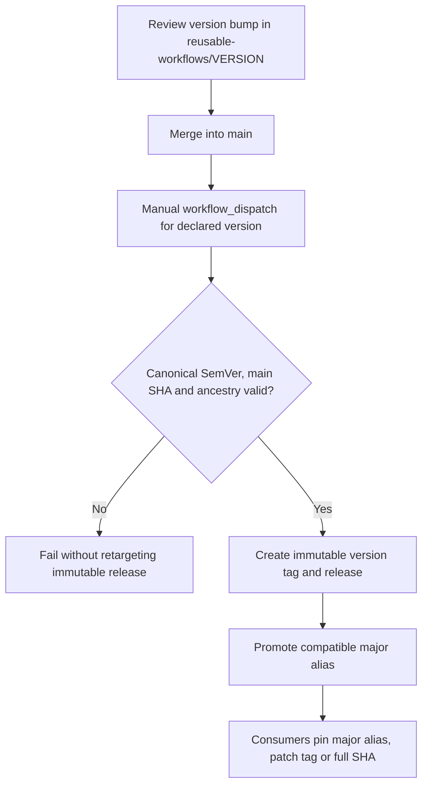

# Execution and decision flows

> [Português](automation-flows.pt-BR.md) · [Architecture](architecture.md) · [Catalog](workflow-catalog.md) · [Operations](operations.md)

These Mermaid diagrams describe **implementation contracts and decisions**. They do not represent historical run outcomes or prove a scheduled job ran successfully. Internal labels retain technical workflow terminology to ease troubleshooting.

## 1. SDK patch synchronization

[`dotnet-sdk-sync.yml`](../.github/workflows/dotnet-sdk-sync.yml)

Only root `global.json` and supported stable updates within the current `major.minor` SDK channel. A collision may select a deterministic recovery branch; otherwise this repository is blocked while the batch continues.

## 2. Read-only .NET inventory

[`dotnet-repository-inventory.yml`](../.github/workflows/dotnet-repository-inventory.yml)

The only App credential is in discovery. Inspection runs without GitHub App keys, uses SHA-pinned DotNetRepoInspector/MSBuild and bounds clone/evaluation timeouts; errors do not silently count as successful inspection.

## 3. Upstream skills to consumer review

[`sync-agent-skills.yml`](../.github/workflows/sync-agent-skills.yml) · [`distribute-agent-skills.yml`](../.github/workflows/distribute-agent-skills.yml)

Only four manifest-owned skills are synchronized and distributed; a consumer is eligible for each skill only if the managed target already exists. Five additional skills and profile instructions remain manual.

## 4. CodeRabbit profile distribution

[`distribute-coderabbit-config.yml`](../.github/workflows/distribute-coderabbit-config.yml)

The workflow uses its own reserved-branch ownership checks, not necessarily the shared SDK/skill recovery policy. The proposed `.coderabbit.yaml` points at a centrally maintained profile on `main`.

## 5. Actions runtime audit and optional remediation

[`actions-runtime-audit.yml`](../.github/workflows/actions-runtime-audit.yml)

A scheduled audit is read-only. Only a manually opted-in `apply_fixes=true` run requests scoped write permissions and opens draft PRs for allowlisted, verifiable official Action changes.

## 6. Reusable Git-history secret scanning

[`reusable-secret-scan.yml`](../.github/workflows/reusable-secret-scan.yml)

The scanner uses base-branch policy when a PR modifies its own suppression settings; incomplete large-blob coverage and tool errors fail closed. `clean` applies only to the examined scope.

## 7. GitHub issue synchronization to Project #1

[`sonar-project-sync.yml`](../.github/workflows/sonar-project-sync.yml)

This workflow searches open labeled **GitHub issues**, not the SonarCloud API. Closed items remain in Project history but disappear from the filtered open-issue view.

## 8. Explicit reusable-workflow publication

[`reusable-workflow-release.yml`](../.github/workflows/reusable-workflow-release.yml)

The reviewer first merges a version bump. A maintainer explicitly dispatches a matching version from `main`. Existing SemVer tags are immutable; the compatible major alias can advance.

## Further reading

For trust boundaries, see [architecture](architecture.md). For blocked mutations, dry-runs and safe recovery, see [operations](operations.md) and the [branch ownership contract](automation-branch-ownership.md).
