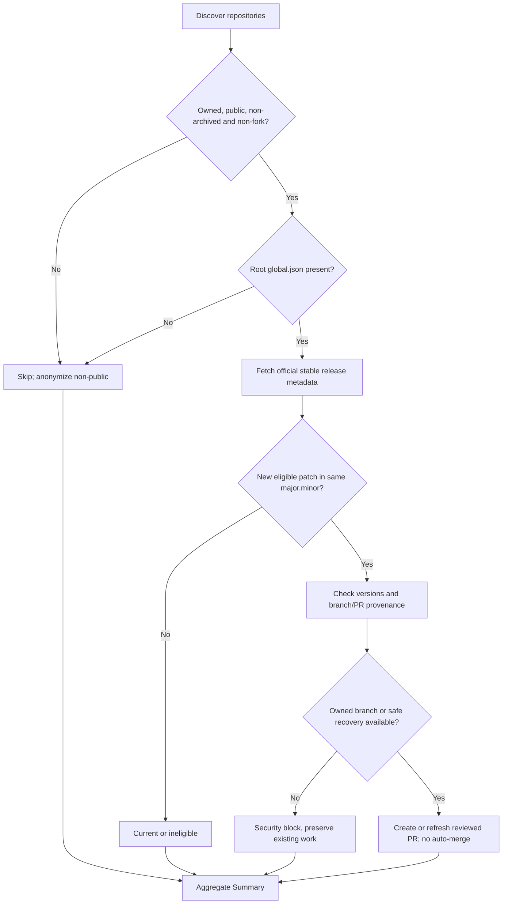
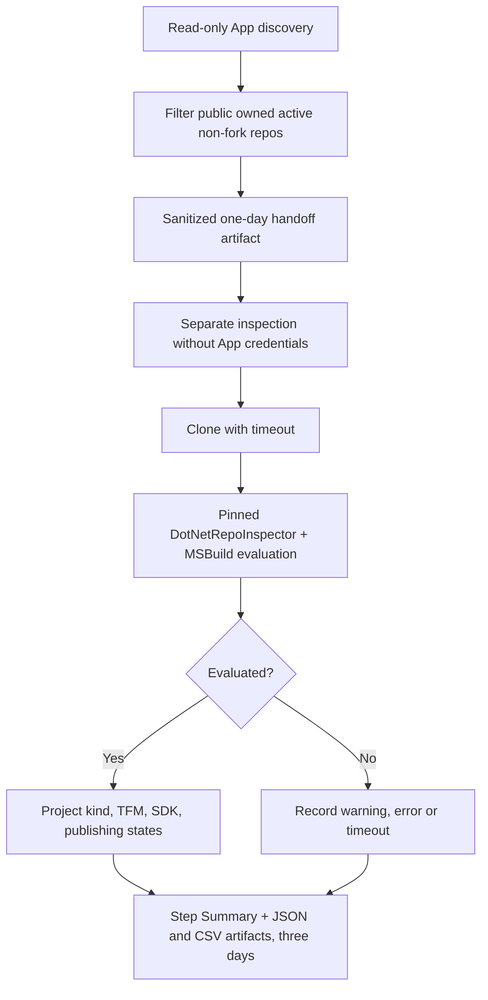
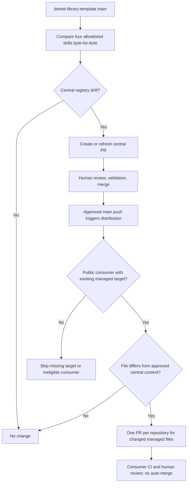
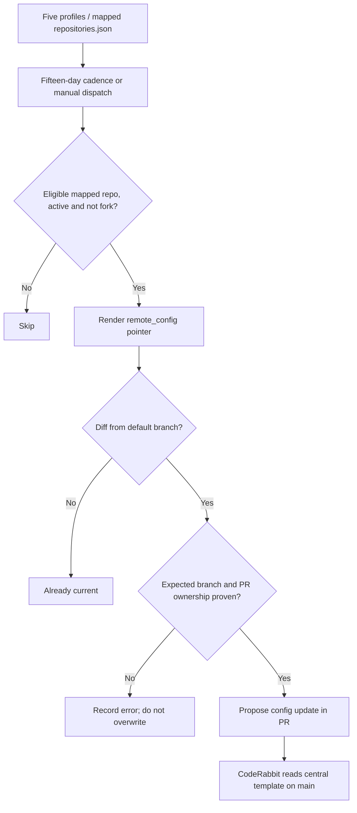
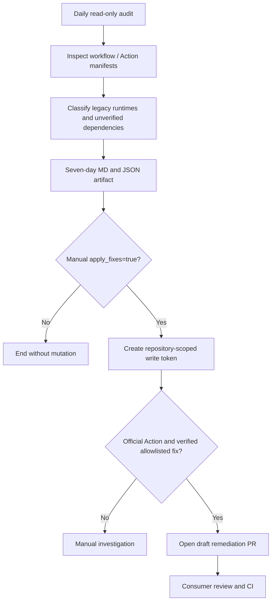
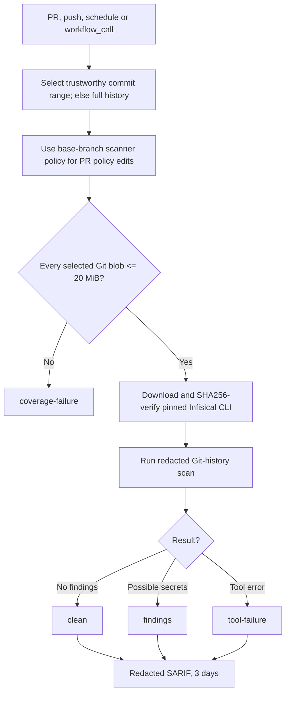
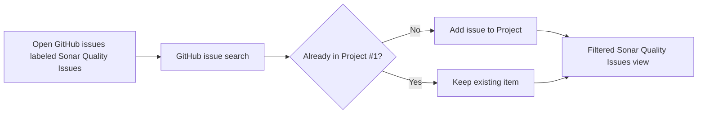
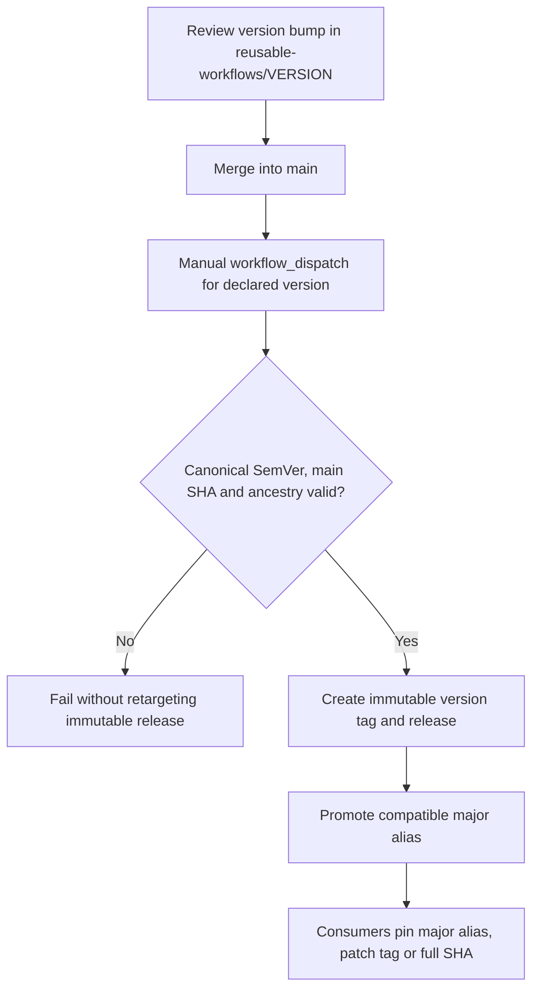

# Fluxos de execução e decisão

> [English](automation-flows.md) · [Arquitetura](architecture.pt-BR.md) · [Catálogo](workflow-catalog.pt-BR.md) · [Operação](operations.pt-BR.md)

Os diagramas Mermaid abaixo descrevem **contratos e decisões previstos pelo código**. Não representam resultados históricos nem comprovam que um agendamento foi executado. Os textos internos dos diagramas preservam os nomes técnicos dos workflows para facilitar investigação em logs.

## 1. Sincronização de patch do SDK

[`dotnet-sdk-sync.yml`](../.github/workflows/dotnet-sdk-sync.yml)

Apenas `global.json` na raiz e atualizações estáveis suportadas no mesmo canal `major.minor` do SDK. Uma colisão pode selecionar branch alternativa determinística; se nenhuma for segura, aquele repositório é bloqueado e o lote continua.

## 2. Inventário .NET somente leitura

[`dotnet-repository-inventory.yml`](../.github/workflows/dotnet-repository-inventory.yml)

A credencial App existe apenas na descoberta. A inspeção não recebe chaves da GitHub App, usa DotNetRepoInspector/MSBuild fixado por SHA e aplica timeout no clone e na avaliação; falhas não contam como inspeção bem-sucedida.

## 3. Skills upstream até revisão do consumidor

[`sync-agent-skills.yml`](../.github/workflows/sync-agent-skills.yml) · [`distribute-agent-skills.yml`](../.github/workflows/distribute-agent-skills.yml)

Apenas quatro skills gerenciadas no manifesto são sincronizadas e distribuídas; o consumidor só é elegível se o alvo gerenciado já existir. Cinco skills e as instruções de perfil continuam manuais.

## 4. Distribuição de perfis CodeRabbit

[`distribute-coderabbit-config.yml`](../.github/workflows/distribute-coderabbit-config.yml)

O workflow usa sua própria validação da branch reservada, que não equivale necessariamente à recuperação compartilhada de SDK/skills. O `.coderabbit.yaml` proposto aponta para um perfil central na `main`.

## 5. Auditoria de runtimes de Actions e remediação opcional

[`actions-runtime-audit.yml`](../.github/workflows/actions-runtime-audit.yml)

A auditoria agendada é somente leitura. Apenas `apply_fixes=true` acionado manualmente solicita permissões de escrita limitadas e cria PRs draft para Actions oficiais permitidas e verificadas.

## 6. Secret scanning reutilizável do histórico Git

[`reusable-secret-scan.yml`](../.github/workflows/reusable-secret-scan.yml)

O scanner usa a política da branch base quando o PR altera suas exclusões; cobertura incompleta de blobs grandes e falhas da ferramenta bloqueiam o check. `clean` se limita ao escopo examinado.

## 7. Sincronização de issues GitHub com Project #1

[`sonar-project-sync.yml`](../.github/workflows/sonar-project-sync.yml)

O workflow busca **issues do GitHub** abertas e rotuladas, não consulta a API SonarCloud. Issues fechadas permanecem no histórico do Project e somem da visão filtrada.

## 8. Publicação explícita de workflow reutilizável

[`reusable-workflow-release.yml`](../.github/workflows/reusable-workflow-release.yml)

O revisor incorpora primeiro o bump de versão. O mantenedor dispara manualmente a versão correspondente na `main`. Tags SemVer existentes são imutáveis; o alias major compatível pode avançar.

## Recursos adicionais

Para as fronteiras de confiança, veja [arquitetura](architecture.pt-BR.md). Para bloqueios, dry-run e recuperação segura, consulte [operações](operations.pt-BR.md) e o [contrato de ownership](automation-branch-ownership.pt-BR.md).
